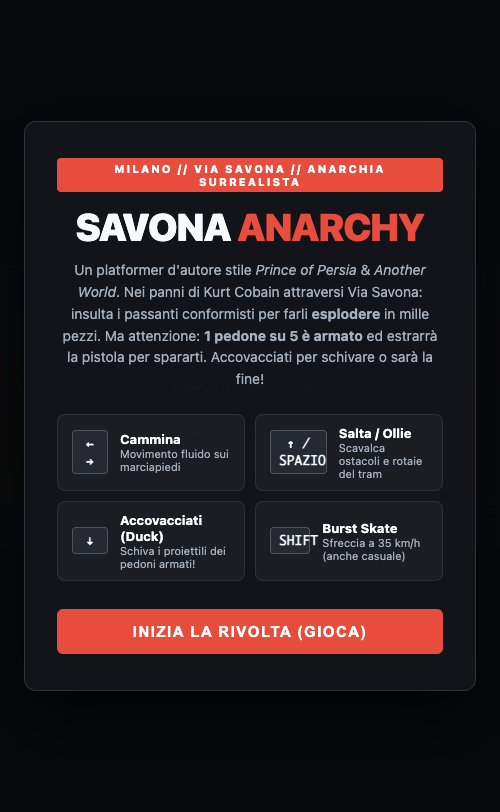
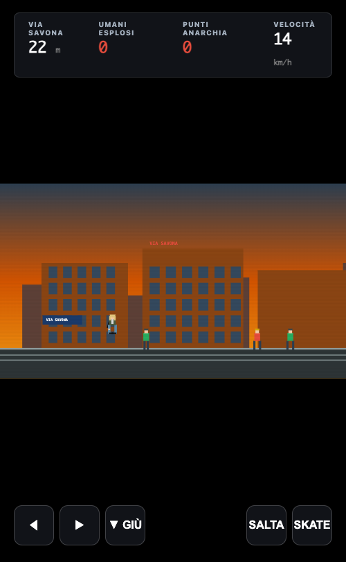
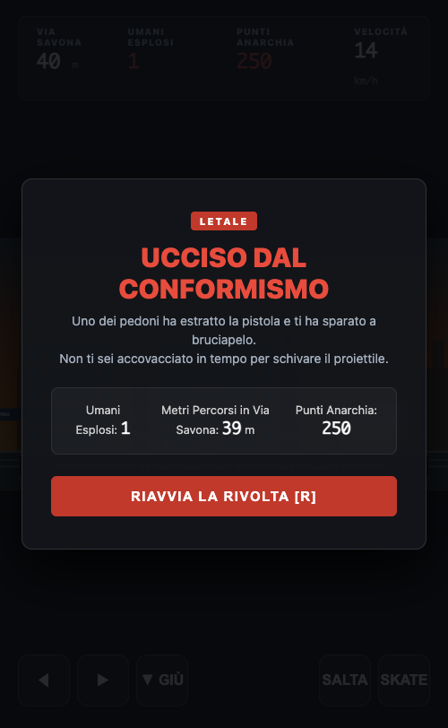
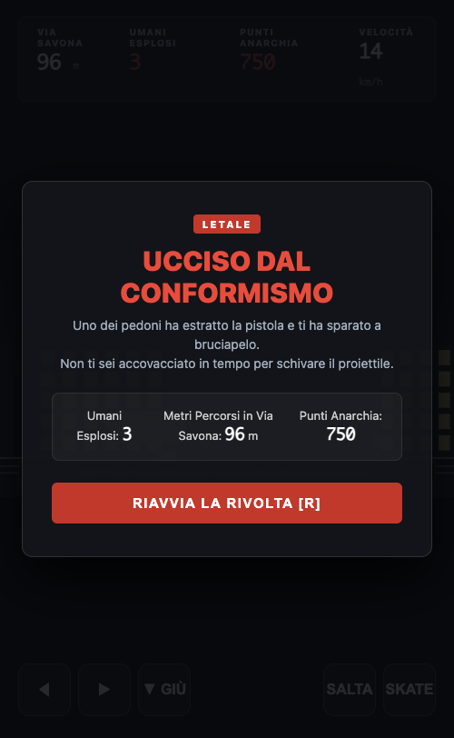

# SAVONA ANARCHY: Kurt Cobain in Via Savona 💥🛹

Un videogioco platformer cinematografico d'autore, surreale e dissacrante, ispirato ai classici storici del rotoscopio (*Prince of Persia*, *Another World*). 

Ambientato in **Via Savona a Milano** (il cuore del distretto del design e della moda di Zona Tortona), vede protagonista un **Kurt Cobain** sgualcito, nichilista e irriverente che cammina lungo i marciapiedi milanesi tra rotaie del tram e loft industriali: **insulta gli umani conformisti facendoli esplodere**, mentre deve schivare i proiettili dei pedoni armati.


---

## 📸 Screenshot Reali dell'Applicazione

### 1. Schermata Iniziale & Manifesto


### 2. Intro Cinematografica a Milano (Ore 03:42)


### 3. Gameplay a Piedi in Via Savona (Tram Storico 19 & Loft)


### 4. Insulto in Italiano & Esplosione Surrealista dell'Umano


### 5. Pedone Armato che Spara & Schermata Game Over Letale


---

## 🎮 Meccaniche di Gioco

- **Movimento Fluido**:
  - `←` `→` / `A` `D` : Camminata dinoccolata d'autore sui marciapiedi di Via Savona.
  - `↑` / `SPAZIO` : Salto fluido stile *Prince of Persia* per scavalcare rotaie del tram e ostacoli.
  - `↓` / `S` : **Accovacciati (Duck)** — fondamentale per schivare i colpi di pistola dei pedoni armati!
  - `SHIFT` : Burst skate manuale a 35 km/h (la tavola viene anche gettata a terra in modo casuale durante la marcia).
- **L'Insulto Fa Esplodere l'Umano**:
  - Quando Kurt si avvicina a un passante, gli urla in italiano un aforisma satirico ed esistenzialista contro il consumismo e la vanità del Fuorisalone.
  - **L'umano esplode all'istante** in una deflagrazione di particelle geometriche, coriandoli e fumo. Kurt attraversa impassibile la nube di detriti e continua a camminare guadagnando punti anarchia.
- **Pericolo Letale: 1 su 5 Spara!**:
  - Il **20% dei pedoni** è armato: appena Kurt si avvicina, compare un punto esclamativo rosso `[!]`, estraggono una pistola ed esplodono un colpo letale a bruciapelo.
  - Se non ti accovacci tempestivamente per far passare il proiettile sopra la testa, Kurt viene colpito e la partita finisce con una drammatica schermata di *Game Over*.
- **Variabili Casuali d'Ambiente**:
  - Ciclo casuale Giorno (crepuscolo industriale) o Notte (blu petrolio milanese).
  - Pioggia milanese casuale con riflessi sull'asfalto.
  - Transito dello storico Tram giallo 19 Carelli sullo sfondo.

---

## 🔊 Sound Design & Sintesi Vocale

- **Esplosione Umana**: Sub-bass boom con detriti materici.
- **Sparo di Pistola**: Crack ad alta pressione con eco riverberato da vicolo urbano.
- **Voce di Kurt**: Web Speech API con recitazione parlata in italiano ad ogni dissacrazione.
- **Riff Grunge**: Drop-D power chord distorti e sferragliamento ruote skate.

---

## 📁 Architettura

```
kind-volta/
├── index.html                           # Entry point HTML con canvas retro-platformer
├── VERSION.txt                          # Versione semantica (3.0.0)
├── CHANGELOG.md                         # Changelog storico dettagliato
├── README.md                            # Documentazione completa con 5 screenshot reali
├── screenshots/                         # Cartella contenente i 5 screenshot reali in-game
│   ├── 1_start_screen.png
│   ├── 2_cinematic_intro.png
│   ├── 3_walking_via_savona.png
│   ├── 4_human_explosion.png
│   └── 5_game_over.png
├── css/
│   └── style.css                        # Layout retro-cinematografico e letterboxing
└── js/
    ├── game.js                          # Ciclo di gioco a 60fps e macchina a stati
    ├── entities.js                      # Kurt rotoscopico, pedoni (con cecchini) e proiettili
    ├── world.js                         # Parallasse di Via Savona, tram 19 e meteo
    ├── particles.js                     # Motore particellare esplosioni e shockwave
    ├── dialogues.js                     # Battute satiriche in italiano e testi intro
    └── audio.js                         # Sound engine (spari, esplosioni, voce italiana)
```

---

## 🚀 Esecuzione

Nessun server complesso o dipendenza da compilare:
```bash
python3 -m http.server 8085
```
Apri `http://localhost:8085` nel browser per giocare.
