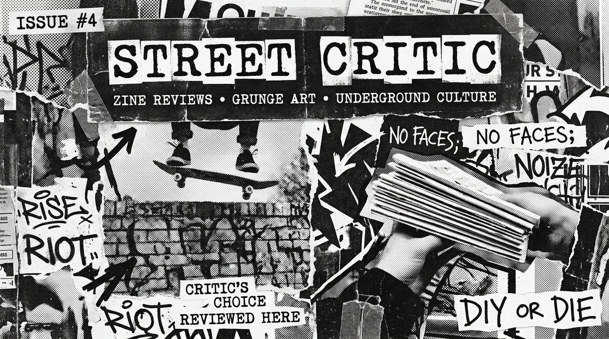

# Kurt Cobain Street Critic // Lo-Fi Grunge Zine & Street Art Critic

<p align="center">
  
</p>

> **Lo-fi 90s grunge zine simulator and satirical street art critique engine built as a tactile client-side PWA.**

---

## Overview

**Kurt Cobain Street Critic** is an interactive, satirical cultural critique application. Steeped in authentic 90s alternative rock visual culture, it recreates the tactile feel of photocopier halftones, torn paper zines, typewriter typography, and caustic street art reviews.

Built as an offline-first PWA, it demonstrates how raw, unconventional aesthetics can be combined with modern web standards.

---

## Key Features

- **Raw Photocopier Halftone Aesthetic**: High-contrast black and white textures, distressed torn paper borders, and typewriter typography.
- **Interactive Satirical Dialogue**: Caustic, witty cultural commentary on modern street art, corporate aesthetics, and consumer culture.
- **Web Audio Soundscape**: Lo-fi analog distortion and tactile click feedback generated directly via the Web Audio API.
- **Offline-First PWA**: Fully functional offline via Service Worker caching.
- **Zero Framework Overhead**: Vanilla JavaScript, modular CSS, zero third-party UI dependencies.

---

## Live Experience

Experience the interactive critique at:  
👉 **[emaf205.com/ideas/kurt-critic](https://emaf205.com/ideas/kurt-critic)**

---

## Installation & Local Run

```bash
git clone https://github.com/emaf205/kurt-cobain-street-critic.git
cd kurt-cobain-street-critic
# Open index.html in any modern browser
```

---

## License & Attribution

Created by **Emanuele BDC (EmaF205)**.  
Released under the [MIT License](LICENSE).
